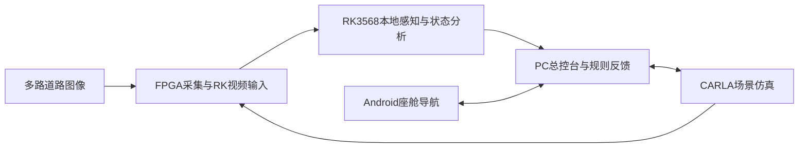

# 智眸领航智能驾驶系统

**基于FPGA与RK3568的多摄像头边缘感知与驾驶辅助原型系统。**

智眸领航将道路图像采集、目标检测、车道线分割、交通灯颜色分析、座舱导航通信和PC可视化整合在同一套软硬件工程中。项目以PGL50H、PG2L50H和RK3568为核心，结合Android座舱与CARLA仿真环境，展示从道路画面输入到感知结果、规则反馈和仿真车辆响应的协同过程。

## 项目背景

驾驶辅助需要同时关注车辆、行人、交通信号和车道结构。单一视角或单一检测结果难以完整表达周围道路状态，而多摄像头方案又对图像采集、数据传输、边缘计算和设备间通信提出了要求。

本项目面向FPGA竞赛与嵌入式系统实践，研究如何让不同处理单元各司其职：由FPGA承担图像采集与传输，由RK3568在本地完成神经网络推理和图像分析，再通过PC总控台、座舱通信与仿真环境组织可观察的系统反馈。项目关注完整链路的工程实现，以及有限边缘算力下多种感知任务的协同。

## 总体方案

系统按“图像输入—边缘感知—信息融合—可视化与反馈”组织。物理摄像头与CARLA仿真提供两类输入，感知结果通过网络和串口链路与PC、座舱交互。

|组成部分|承担的任务|
|---|---|
|PGL50H / PG2L50H|双目图像采集、SFP级联及PCIe视频传输|
|RK3568边缘计算|运行INT8目标检测和车道线模型，完成灯色、道路状态及规则辅助分析|
|PC总控台|集中展示视频、感知信息、导航与车辆状态，管理不同演示场景|
|Android座舱|导航目的地交互、串口报文及挡位联动接口|
|CARLA仿真环境|提供道路场景、车辆与相机输入，展示导航和辅助制动等反馈流程|

## 主要功能

- **道路目标检测**：采用YOLOv8n 11类检测模型，识别行人、车辆、交通灯、交通标志及斑马线等目标。
- **车道线感知**：采用R15 TwinLiteNet+ Small分割模型，输出可行驶区域及背景、实线、虚线类别信息。
- **交通灯颜色分析**：结合检测区域内的颜色特征，提供灯色辅助判断。
- **多路视频观察**：接入双目与USB摄像头，展示前后及侧向道路画面；不同任务按各模式的计算策略执行。
- **感知与规则反馈**：结合目标、车道、交通灯及测距信息，生成可在总控台观察的道路状态与规则结果。
- **座舱与仿真联动**：通过导航和通信接口连接座舱、PC与CARLA，在指定仿真场景中展示车辆反馈和辅助制动流程。

## 技术特点

1. **软硬件分工明确**：结合FPGA的视频采集/传输能力与RK3568的本地推理能力，构建多设备协同链路。
2. **边缘端双模型感知**：目标检测与车道线分割使用两份INT8 RKNN模型，配合CPU侧图像分析和规则处理。
3. **实景与仿真结合**：支持物理摄像头、CARLA图像和离线视频，便于分别观察感知、通信与反馈过程。
4. **从模型到系统的工程归档**：保留训练源码、配置、转换材料、部署模型和硬件工程，便于理解各模块来源与实现。

## 场景展示

|场景|展示内容|
|---|---|
|物理四路摄像头|多路道路画面、目标检测、前视车道线及统一视频展示|
|静止车辆决策演示|感知状态、规则摘要与车辆灯光/车轮等反馈|
|CARLA导航与辅助制动|座舱导航通信、仿真车辆、相机感知及指定场景下的控制反馈|
|离线视频分析|对原始道路视频输出检测、分割与状态结果|

本项目定位为竞赛与研究演示原型。感知效果和控制反馈应结合具体场景评价，仿真演示不等同于真实道路自动驾驶验证。

## 了解更多

- [系统实现与代码结构](docs/ARCHITECTURE_zh.md)
- [部署和使用手册](docs/USER_GUIDE_zh.md)
- [启动命令速查](docs/START_COMMANDS_zh.md)
- [硬件工程与位流说明](hardware/README_zh.md)
- [YOLO与R15训练材料](training/README.md)
- [运行及训练环境](environment/README_zh.md)
- [提交范围与归档说明](docs/DEPLOYMENT_AND_ARCHIVE_NOTES_zh.md)
- [第三方组件与来源](NOTICE.md)
