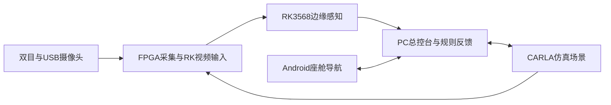

# 智眸领航智能驾驶系统

**基于FPGA与RK3568的多摄像头道路感知及驾驶辅助系统。**

智眸领航将图像采集、边缘推理、道路状态分析与座舱通信连接起来，形成面向FPGA竞赛的软硬件协同作品。系统由PGL50H、PG2L50H、RK3568、PC总控台和Android座舱组成，支持物理摄像头、CARLA仿真与离线视频三类输入。

## 项目背景

道路信息具有多目标、多视角和动态变化的特点。车辆、行人、信号灯与车道结构需要同时处理，而嵌入式平台的算力、带宽和接口资源有限。项目围绕这一工程问题，将FPGA的视频采集与传输、RK3568的本地视觉推理和PC的交互展示分工实现，并通过串口和网络形成协同链路。

## 系统方案

|模块|实现内容|
|---|---|
|FPGA视频链路|双目采集、DDR缓存、SFP级联和PCIe传输|
|道路目标检测|YOLOv8n 11类模型，覆盖行人、车辆、交通灯、交通标志和斑马线等目标|
|车道结构识别|R15 TwinLiteNet+ Small，输出可行驶区域及实线、虚线分割结果|
|道路状态分析|结合灯色、目标、车道和测距信息生成规则状态|
|PC与座舱交互|集中展示视频、感知摘要、导航消息与车辆反馈|

## 功能展示

- **物理四路观察**：前后双目与左右USB画面接入RK，完成四路目标检测和前视车道线叠加。
- **静止车辆决策**：将道路感知结果转换为车辆灯光、前轮和报警状态反馈。
- **导航与辅助制动仿真**：接收座舱导航消息，在CARLA中展示车辆行驶、行人横穿识别、制动与续行过程。
- **离线视频分析**：逐帧输出目标检测、道路分割、标注视频和结构化摘要。

两份INT8模型在RK3568本地执行，CPU承担预处理、结果融合和显示。项目提供硬件工程、部署模型、训练源码和通信实现，便于按模块阅读与复现。系统定位为竞赛与研究原型；仿真控制效果与真实道路自动驾驶验证分别评价。

## 工程文档

- [文档导航](docs/README.md)
- [系统架构与代码实现](docs/ARCHITECTURE_zh.md)
- [功能演示与使用](docs/USER_GUIDE_zh.md)
- [硬件设计](hardware/README_zh.md)
- [模型与训练](training/README.md)
- [验证依据](verification/README.md)
- [第三方组件](NOTICE.md)
